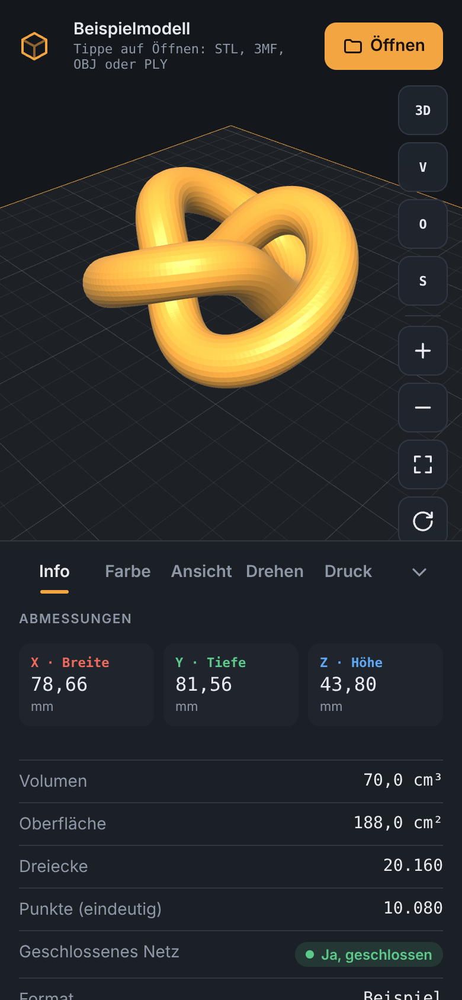
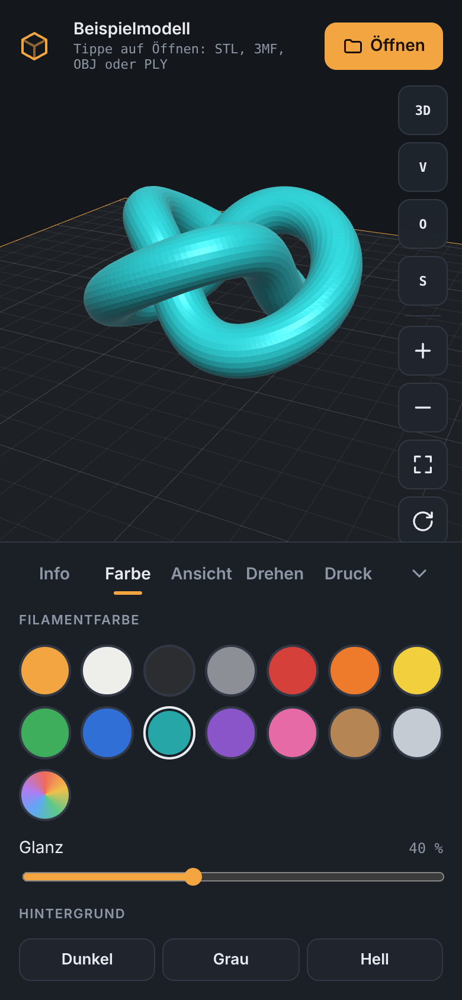
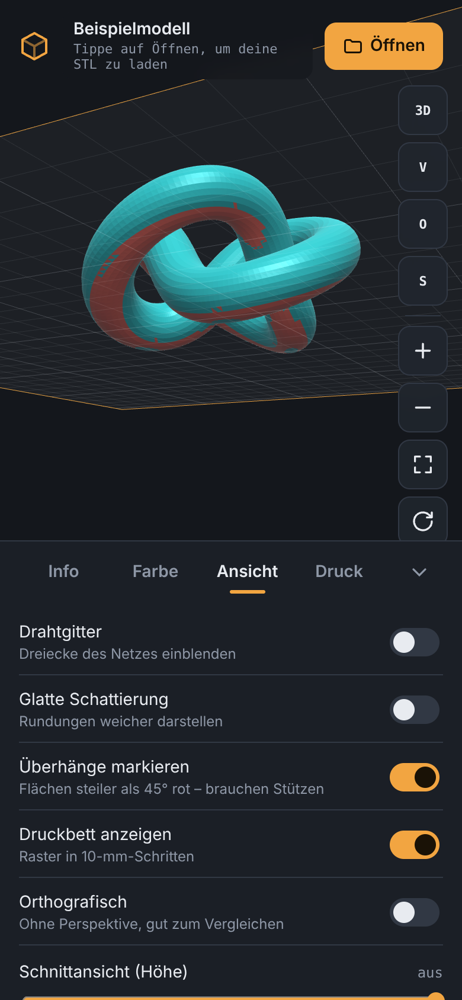
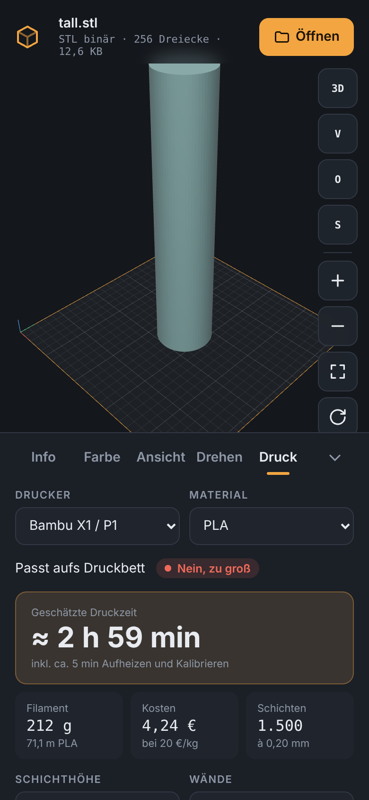

# Modellblick

**3D-Modell-Viewer für Android – STL, 3MF, OBJ und PLY.** 3D-Modelle am Handy ansehen, drehen, zoomen, einfärben und vor dem Druck prüfen – offline, ohne Konto, ohne Werbung.

<p>
  
  
  
  
</p>

## Download

### Android

**[➜ Neueste Version herunterladen](../../releases/latest)** – dort die Datei `Modellblick-….apk` antippen.

1. APK am Android-Handy herunterladen und öffnen.
2. Beim ersten Mal fragt Android, ob der Browser bzw. Dateimanager Apps installieren darf → **erlauben**.
3. **Installieren** tippen. Neue Versionen installierst du genauso, sie ersetzen die alte.

Voraussetzung: Android 8.0 oder neuer mit OpenGL ES 3.0 (praktisch alle Geräte ab 2017).

> Google Play Protect kann bei Apps außerhalb des Play Store nachfragen. Das ist normal für frei verteilte APKs.

### iPhone und iPad

**[➜ snckz.github.io/STL-VIEWER](https://snckz.github.io/STL-VIEWER/)** in **Safari** öffnen, dann:

1. Unten auf **Teilen** <kbd>⬆︎</kbd> tippen.
2. **Zum Home-Bildschirm** wählen und **Hinzufügen** tippen.
3. Modellblick startet ab jetzt vom Home-Bildschirm wie eine App – im Vollbild und auch ohne Internet.

Dateien öffnest du über **Öffnen** in der App (Dateien, iCloud Drive, Downloads). Das Kamera-Symbol öffnet das Teilen-Menü, dort **Bild sichern** wählen. Voraussetzung: iOS/iPadOS 16.4 oder neuer.

> Warum keine App aus dem App Store? Apple erlaubt Apps außerhalb des App Store nur mit kostenpflichtigem Entwicklerkonto. Die Web-App bietet dieselben Funktionen und braucht das nicht. Updates kommen automatisch beim nächsten Start mit Internet.

Die Web-App funktioniert genauso am Computer (Chrome/Edge: Symbol „Installieren“ in der Adressleiste).

## Funktionen

- **Ansehen:** ein Finger dreht, zwei Finger zoomen und verschieben, Doppeltipp passt das Modell ein. Ansichten von vorne, oben, seitlich und schräg, Auto-Drehen.
- **Einfärben:** 14 Filamentfarben oder eine eigene Farbe, Glanz-Regler, drei Hintergründe.
- **Infos:** Maße X/Y/Z in mm, Volumen, Oberfläche, Anzahl Dreiecke und Punkte, Format, Dateigröße.
- **Netzprüfung:** zeigt, ob das Modell geschlossen ist oder offene Kanten und Mehrfachkanten hat.
- **Drehen:** Modell frei um X, Y und Z drehen (Regler oder Gradzahl eintippen), +90°-Knöpfe, „Flach hinlegen“ legt die größte ebene Fläche aufs Bett. Größe ändern, auch Zoll → mm.
- **Druckvorschau:** geschätzte Druckzeit, Filament in Gramm und Metern, Kosten und Schichtanzahl – abhängig von Drucker (Bambu, Prusa, Creality, Voron), Material (PLA, PETG, ABS, ASA, TPU, Nylon), Schichthöhe, Füllung, Wänden und Stützen. Ein Schichtregler zeigt Schicht für Schicht, wie weit der Druck nach welcher Zeit ist. Warnung, wenn das Modell nicht aufs Bett passt.
- **Analyse:** Überhänge über 45° rot markieren, Drahtgitter, Schnittansicht nach Höhe, glatte und orthografische Darstellung.
- **Android:** Modelldateien direkt aus Dateimanager oder Downloads mit „Öffnen mit …“ bzw. „Teilen“ öffnen. Ansicht als Bild in der Galerie speichern (`Bilder/Modellblick`).

Unterstützte Formate:

| Format | Details |
|---|---|
| **STL** | binär und ASCII |
| **3MF** | Projekte aus Bambu Studio, OrcaSlicer, PrusaSlicer, Cura, Fusion u. a. – mit mehreren Teilen, Unterbaugruppen und Einheiten (mm, cm, Zoll …). Geslicte 3MF mit nur G-Code werden erkannt. |
| **OBJ** | Polygone werden trianguliert, Y-oben wird zu Z-oben gedreht |
| **PLY** | ASCII und binär; reine Punktwolken ohne Flächen werden nicht angezeigt |

STEP/STP und andere CAD-Formate werden nicht unterstützt – sie enthalten keine Dreiecksnetze und müssten erst umgerechnet werden.

## Datenschutz

Modellblick hat **keine Internet-Berechtigung**. Dateien werden nur auf dem Gerät gelesen und nirgendwohin übertragen. Es gibt keine Analyse, kein Tracking und keine Werbung.

## Aufbau

| Pfad | Inhalt |
|---|---|
| `web/viewer.html` | Der komplette Viewer (WebGL 2, ohne externe Bibliotheken) |
| `web/build.mjs` | Erzeugt daraus `index.html` für die App (`--offline` entfernt Web-Schriften) |
| `android/` | Android-App: WebView-Hülle in Java, ohne Zusatzbibliotheken |
| `.github/workflows/build-apk.yml` | Baut bei jedem Push die signierte APK und veröffentlicht sie als Release |
| `.github/workflows/pages.yml` | Baut die installierbare Web-App (iPhone/iPad) und veröffentlicht sie über GitHub Pages |
| `web/pwa/` | Manifest, Icons und Service Worker der Web-App |
| `test/` | Browser-Tests mit Playwright und Testdateien |
| `docs/` | Bilder für diese Seite |

## Selbst bauen

**Lokal (Android Studio):** `node web/build.mjs android/app/src/main/assets/index.html --offline` ausführen, dann den Ordner `android` öffnen und *Build → Build APK(s)* wählen. Ohne Signaturschlüssel entsteht eine Debug-APK zum Testen.

**Eigener Fork mit automatischen Releases:** Der Workflow braucht zwei Repository-Secrets (*Settings → Secrets and variables → Actions*):

| Secret | Inhalt |
|---|---|
| `KEYSTORE_BASE64` | Der Keystore als Base64 (`base64 -w0 release.keystore`) |
| `KEYSTORE_PASSWORD` | Passwort des Keystores (Alias `modellblick`) |

Einen Schlüssel erzeugst du mit:

```bash
keytool -genkeypair -keystore release.keystore -storetype PKCS12 -alias modellblick \
  -keyalg RSA -keysize 4096 -validity 18250 -dname "CN=Modellblick"
```

Den Keystore nie ins Repository hochladen – `.gitignore` schließt `*.keystore` und `*.jks` aus.

**Tests:**

```bash
python3 test/make_fixtures.py
node web/build.mjs
node test/formats.mjs
node test/e2e.mjs . <ordner-fuer-screenshots>
```

## Hinweise

- Druckzeit und Filament sind Schätzungen (etwa ±30 %), berechnet aus den Querschnitten des Modells und typischen Slicer-Profilen. Den exakten Wert liefert der Slicer.
- OBJ-Dateien werden von Y-oben nach Z-oben gedreht, wie in Slicern üblich.
- Sehr große Dateien (mehrere Millionen Dreiecke) hängen vom Speicher des Geräts ab.

## Lizenz

[MIT](LICENSE)
